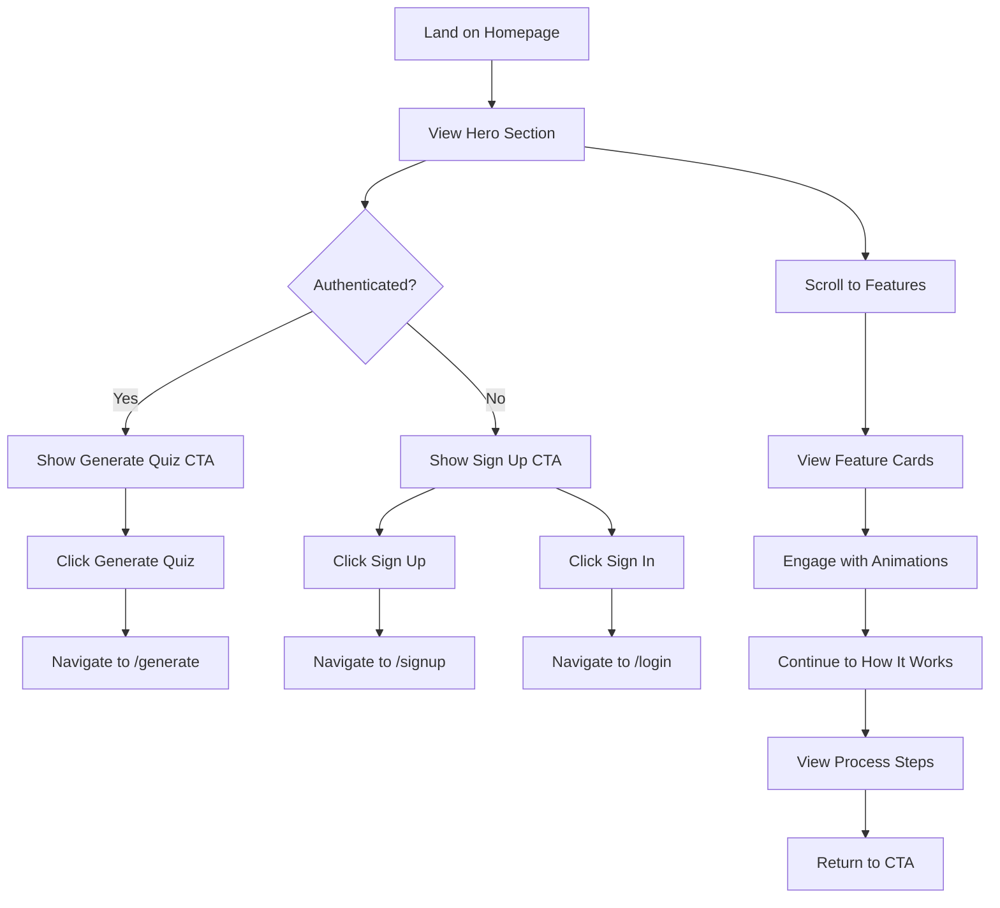
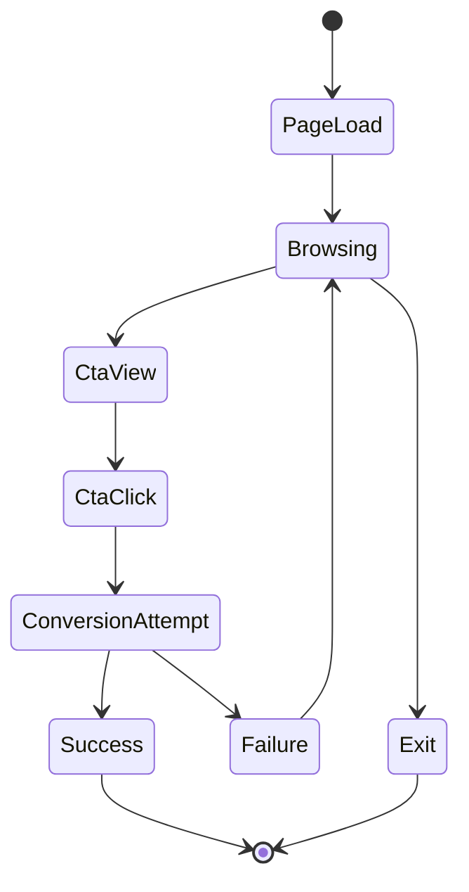

# Data Model: Homepage SAAS

**Feature**: Homepage SAAS | **Date**: 2025-01-28 | **Phase**: 1 - Design

## Core Entities

### HomepageMetrics
**Purpose**: Track homepage performance and user interactions
**Storage**: Appwrite Collection `homepage_metrics`

```typescript
interface HomepageMetrics {
  id: string;                    // Document ID
  sessionId: string;             // User session identifier
  userId?: string;               // Authenticated user ID (optional)
  timestamp: string;             // ISO timestamp
  pageView: {
    loadTime: number;            // Page load time in ms
    lcp: number;                 // Largest Contentful Paint
    fcp: number;                 // First Contentful Paint
    cls: number;                 // Cumulative Layout Shift
    fid: number;                 // First Input Delay
  };
  userAgent: string;             // Browser/device info
  viewport: {
    width: number;
    height: number;
  };
  referrer?: string;             // Traffic source
  createdAt: string;             // Document creation time
}
```

**Validation Rules**:
- `sessionId`: Required, max 128 chars
- `timestamp`: Required, ISO 8601 format
- `loadTime`: Required, positive number ≤ 30000
- `lcp`: Required, positive number ≤ 10000
- `userAgent`: Required, max 512 chars

### ConversionEvents
**Purpose**: Track user conversion actions on homepage
**Storage**: Appwrite Collection `conversion_events`

```typescript
interface ConversionEvent {
  id: string;                    // Document ID
  sessionId: string;             // Links to HomepageMetrics
  userId?: string;               // User ID if authenticated
  eventType: ConversionType;     // Type of conversion action
  eventData: {
    ctaText: string;             // Text of CTA clicked
    ctaPosition: string;         // Position on page (hero, features, footer)
    scrollDepth: number;         // Percentage scrolled when clicked
    timeOnPage: number;          // Time spent before conversion (ms)
  };
  timestamp: string;             // When event occurred
  successful: boolean;           // Whether conversion completed
  errorMessage?: string;         // If conversion failed
  createdAt: string;
}

enum ConversionType {
  SIGNUP_CLICKED = 'signup_clicked',
  LOGIN_CLICKED = 'login_clicked', 
  GENERATE_CLICKED = 'generate_clicked',
  LEARN_MORE_CLICKED = 'learn_more_clicked',
  CONTACT_CLICKED = 'contact_clicked'
}
```

**Validation Rules**:
- `eventType`: Required, must be valid ConversionType
- `scrollDepth`: Required, 0-100
- `timeOnPage`: Required, positive number
- `ctaText`: Required, max 100 chars

### FeatureEngagement
**Purpose**: Track which homepage sections users engage with
**Storage**: Appwrite Collection `feature_engagement`

```typescript
interface FeatureEngagement {
  id: string;
  sessionId: string;
  sectionName: string;           // hero, features, testimonials, how-it-works, cta
  engagementType: EngagementType;
  duration: number;              // Time spent in section (ms)
  scrollDepth: number;           // How much of section viewed (0-100)
  interactions: number;          // Number of clicks/taps in section
  timestamp: string;
  createdAt: string;
}

enum EngagementType {
  VIEW = 'view',                 // Section entered viewport
  INTERACT = 'interact',         // User clicked/tapped in section
  COMPLETE_VIEW = 'complete_view' // User scrolled through entire section
}
```

**Validation Rules**:
- `sectionName`: Required, must be predefined section
- `duration`: Required, positive number ≤ 300000 (5 min max)
- `scrollDepth`: Required, 0-100

## State Transitions

### User Journey Flow


### Conversion Tracking States


## Data Relationships

### Session Tracking
- `HomepageMetrics.sessionId` ← Primary session identifier
- `ConversionEvent.sessionId` → Links to homepage session
- `FeatureEngagement.sessionId` → Links to homepage session

### User Association
- `HomepageMetrics.userId` → Links to Appwrite User (optional)
- `ConversionEvent.userId` → Links to Appwrite User (optional)

### Analytics Aggregation
- Group by `sessionId` for user journey analysis
- Group by `userId` for authenticated user behavior
- Group by `timestamp` for time-based analytics

## Database Indexes

### Appwrite Collection Indexes
```json
{
  "homepage_metrics": [
    {"key": "sessionId", "type": "key"},
    {"key": "userId", "type": "key"},
    {"key": "timestamp", "type": "key"},
    {"key": "createdAt", "type": "key"}
  ],
  "conversion_events": [
    {"key": "sessionId", "type": "key"},
    {"key": "eventType", "type": "key"},
    {"key": "timestamp", "type": "key"},
    {"key": "successful", "type": "key"}
  ],
  "feature_engagement": [
    {"key": "sessionId", "type": "key"},
    {"key": "sectionName", "type": "key"},
    {"key": "engagementType", "type": "key"}
  ]
}
```

## Privacy and Compliance

### Data Collection Principles
- **Minimal Collection**: Only collect data necessary for optimization
- **Consent-Based**: Respect user privacy preferences
- **Anonymization**: Support anonymous session tracking
- **Retention**: Auto-delete analytics data after 90 days

### GDPR Compliance
- Users can request data deletion via Appwrite user deletion
- Session data automatically anonymized after 30 days
- No PII stored without explicit consent