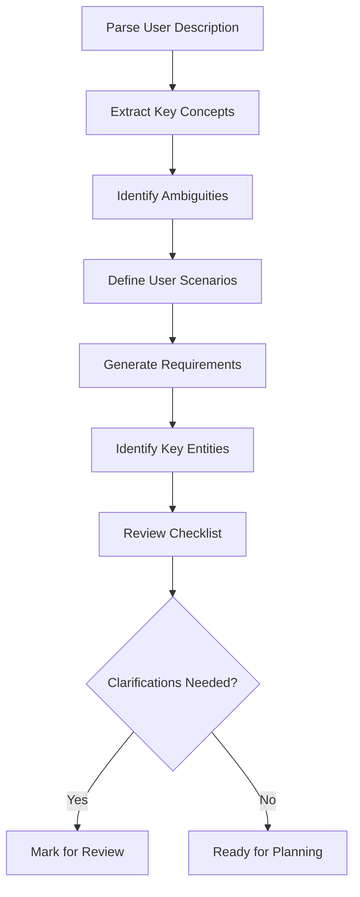

# 🔐 MFA Security Comparison Platform

> **Feature Specification Document**

---

## 📋 Project Overview

| Field | Value |
|-------|-------|
| **Feature Branch** | `003-mfa-security-comparison` |
| **Created** | 2025-09-30 |
| **Status** | 🟡 Draft |
| **Priority** | High |

### 🎯 Project Description
Educational authentication security testing environment with five authentication methods (password-only, SMS MFA, TOTP MFA, security questions, hardware token) and attack simulations (credential stuffing, brute force, phishing) to demonstrate MFA effectiveness.

---

## 🚀 Execution Flow

### 📊 Current Status
- ✅ User description parsed
- ✅ Key concepts extracted  
- ⚠️ Ambiguities marked (3 clarifications needed)
- ✅ User scenarios defined
- ✅ Requirements generated
- ✅ Entities identified
- ❌ Review checklist passed (pending clarifications)

---

## 🎯 Quick Guidelines

> **Focus Areas**
> - ✅ Focus on WHAT users need and WHY
> - ❌ Avoid HOW to implement (no tech stack, APIs, code structure)
> - 👥 Written for business stakeholders, not developers

---

## 👥 User Scenarios & Testing

### 🎭 Primary User Story

> **As a** security researcher or educator  
> **I want to** demonstrate the effectiveness of different Multi-Factor Authentication (MFA) methods against common attack vectors  
> **So that** I can educate others about the importance of strong authentication security and show measurable differences between authentication approaches.

### ✅ Acceptance Scenarios

#### Scenario 1: Authentication Method Selection
- **Given** a new research session is started
- **When** I select an authentication method to test (password-only, SMS MFA, TOTP MFA, security questions, or hardware token)
- **Then** the system creates a test environment with that authentication method configured

#### Scenario 2: Test Account Creation
- **Given** an authentication method is configured
- **When** I create test user accounts with valid credentials
- **Then** the system stores these accounts securely and allows me to attempt authentication

#### Scenario 3: Credential Stuffing Simulation
- **Given** test accounts exist
- **When** I run a credential stuffing simulation with compromised credentials
- **Then** the system attempts automated logins and records success rates, failed attempts, and time-to-breach metrics

#### Scenario 4: Brute Force Attack Simulation
- **Given** test accounts exist
- **When** I run a brute force attack simulation using common passwords
- **Then** the system tests password vulnerability and records attack success rates and lockout effectiveness

#### Scenario 5: Phishing Scenario Simulation
- **Given** test accounts exist with MFA enabled
- **When** I run a phishing scenario simulation
- **Then** the system evaluates which MFA methods remain vulnerable to social engineering versus phishing-resistant methods

#### Scenario 6: Comparison Report Generation
- **Given** multiple attack simulations have been completed
- **When** I request a comparison report
- **Then** the system displays attack success rates, time-to-breach, attempts-before-lockout, and effectiveness ratings for each authentication method

#### Scenario 7: MFA Effectiveness Demonstration
- **Given** simulation results exist
- **When** I view the comparison dashboard
- **Then** the system shows that MFA reduces attack success rates to below 5% compared to password-only authentication

#### Scenario 8: MFA Method Comparison
- **Given** simulation results exist
- **When** I compare TOTP authenticator apps versus SMS MFA
- **Then** the system demonstrates approximately 40.8% effectiveness gap between these methods

### ⚠️ Edge Cases

- What happens when a test account reaches lockout threshold during simulation?
- How does the system handle concurrent attack simulations on different authentication methods?
- What happens if simulation parameters exceed realistic attack volumes?
- How does the system ensure attack simulations remain isolated and don't affect real systems?
- What happens when hardware token simulation attempts occur without registered tokens?

---

## 📋 Requirements

### 🔐 Authentication Methods

| ID | Requirement | Priority |
|----|-------------|----------|
| **FR-001** | System MUST provide five distinct authentication method implementations: password-only, SMS-based MFA, TOTP authenticator app MFA, security questions, and hardware token (FIDO2/WebAuthn principles) | High |
| **FR-002** | System MUST allow users to create test accounts for each authentication method with appropriate credentials (passwords, phone numbers, security question answers, hardware tokens) | High |
| **FR-003** | System MUST implement account lockout mechanisms after configurable failed login attempts (default: 5 attempts) | Medium |
| **FR-004** | System MUST securely store test credentials using industry-standard hashing for passwords and answers | High |
| **FR-005** | Password-only method MUST serve as the baseline for security comparisons | High |

### ⚔️ Attack Simulations

| ID | Requirement | Priority |
|----|-------------|----------|
| **FR-006** | System MUST simulate credential stuffing attacks that attempt automated logins using provided compromised credential lists | High |
| **FR-007** | Credential stuffing simulation MUST mimic documented success rates of 0.2%-2% for realistic scenarios | High |
| **FR-008** | System MUST simulate brute force attacks testing common passwords like "123456", "password", "qwerty" | High |
| **FR-009** | System MUST simulate phishing scenarios that evaluate social engineering vulnerability of each MFA method | High |
| **FR-010** | Phishing simulation MUST differentiate between phishing-vulnerable methods (SMS, security questions) and phishing-resistant methods (hardware tokens) | High |
| **FR-011** | All attack simulations MUST be clearly labeled as educational and confined to test environments only | Critical |
| **FR-012** | System MUST prevent simulations from being used against production systems or real user accounts | Critical |

### 📊 Metrics & Analysis

| ID | Requirement | Priority |
|----|-------------|----------|
| **FR-013** | System MUST collect attack success rate as percentage of successful breaches per authentication method | High |
| **FR-014** | System MUST measure time-to-breach in seconds or minutes for successful attacks | High |
| **FR-015** | System MUST record number of attempts before account lockout is triggered | Medium |
| **FR-016** | System MUST calculate attack complexity score based on resources and time required | Medium |
| **FR-017** | System MUST demonstrate that MFA reduces credential-based attack success rates to below 5% compared to password-only baseline | High |
| **FR-018** | System MUST show effectiveness differences between MFA methods, particularly the 40.8% gap between TOTP authenticator apps and SMS (based on Microsoft research) | High |
| **FR-019** | System MUST generate comparison reports showing side-by-side metrics for all authentication methods | High |
| **FR-020** | System MUST provide visual representations of security effectiveness (charts, graphs, tables) | Medium |

### 🎨 User Experience

| ID | Requirement | Priority |
|----|-------------|----------|
| **FR-021** | Users MUST be able to select which authentication method to test | High |
| **FR-022** | Users MUST be able to configure simulation parameters (number of attempts, credential lists, attack duration) | Medium |
| **FR-023** | Users MUST be able to start, pause, and stop attack simulations | Medium |
| **FR-024** | Users MUST receive real-time progress updates during simulations | Medium |
| **FR-025** | Users MUST be able to export simulation results and reports | Low |
| **FR-026** | System MUST provide clear educational context and research citations for each authentication method | Medium |
| **FR-027** | System MUST display security level ratings (low, medium, high, very-high) for each authentication method | Medium |

### 🛡️ Safety & Ethics

| ID | Requirement | Priority |
|----|-------------|----------|
| **FR-028** | System MUST include prominent disclaimers that it is for educational and defensive security research only | Critical |
| **FR-029** | System MUST prevent misuse by not allowing connections to external systems during simulations | Critical |
| **FR-030** | System MUST log all simulation activities for accountability | High |
| **FR-031** | System MUST provide guidance on responsible security research practices | Medium |

---

## 🏗️ Key Entities

### 🔑 Authentication Method
Represents one of five authentication approaches (password-only, SMS MFA, TOTP MFA, security questions, hardware token) with associated security characteristics, implementation details, and known vulnerabilities.

### 👤 Test Account
Represents a simulated user account with credentials appropriate to the authentication method (username, password, MFA secrets, security answers, registered tokens), lockout status, and attempt tracking.

### ⚔️ Attack Simulation
Represents a specific attack scenario (credential stuffing, brute force, phishing) with configuration parameters, execution state, and progress tracking.

### 📊 Security Metric
Represents measured data from attack simulations including success rate percentage, time-to-breach duration, attempts-before-lockout count, and attack complexity rating.

### 📈 Simulation Result
Represents the outcome of a completed attack simulation including all collected metrics, authentication method tested, attack type performed, and timestamp.

### 📋 Comparison Report
Aggregates multiple simulation results to show side-by-side effectiveness comparisons between authentication methods with visual charts and statistical analysis.

### 🔐 Hardware Token
Represents a simulated FIDO2/WebAuthn security key with credential ID, public key, registration timestamp, and usage count.

### 🔄 Challenge-Response
Represents cryptographic challenges used in hardware token authentication with challenge string, expected response, and expiration time.

---

## ✅ Review & Acceptance Checklist

### 📝 Content Quality
- [x] No implementation details (languages, frameworks, APIs)
- [x] Focused on user value and business needs
- [x] Written for non-technical stakeholders
- [x] All mandatory sections completed

### 📋 Requirement Completeness
- [ ] No [NEEDS CLARIFICATION] markers remain (3 outstanding)
- [x] Requirements are testable and unambiguous
- [x] Success criteria are measurable
- [x] Scope is clearly bounded
- [x] Dependencies and assumptions identified

### ⚠️ Outstanding Clarifications
1. **Target audience specificity** - academic institution, security training company, or general public education?
2. **Data retention policy** - should historical test results be persisted across sessions?
3. **Multi-user support** - concurrent testing by multiple researchers or single-user only?

---

## 📚 Research References

This specification is based on documented research from:

- **Microsoft Security**: "MFA blocks 99.9% of account compromise attacks"
- **Google Security**: "Security keys eliminate phishing"
- **NIST SP 800-63B**: Digital Identity Guidelines

---

## 🎯 Success Criteria

The implementation will be considered successful if it demonstrates:

1. **MFA Effectiveness**: MFA reduces attack success rates to below 5% (vs. baseline password-only)
2. **Method Differentiation**: Clear effectiveness differences between MFA methods are measurable
3. **SMS vs TOTP Gap**: 40.8% effectiveness gap between TOTP authenticator apps and SMS is shown
4. **Hardware Token Security**: Hardware tokens provide near-complete phishing resistance (<0.1% success rate)

---

## ⚖️ Ethical Considerations

> **Important**: This platform is designed exclusively for defensive security research and education. All attack simulations are conducted in isolated, controlled environments with no capability to target real systems or users. The goal is to educate about security improvements, not to provide tools for malicious activity.

---

## 📊 Priority Matrix

| Requirement Category | Priority | Impact | Effort |
|---------------------|----------|--------|--------|
| Authentication Methods | High | High | Medium |
| Attack Simulations | High | High | High |
| Metrics & Analysis | High | High | Medium |
| Safety & Ethics | Critical | High | Low |
| User Experience | Medium | Medium | Medium |

---

## 🚦 Next Steps

1. **Address Clarifications** - Resolve the 3 outstanding clarification points
2. **Stakeholder Review** - Present to business stakeholders for approval
3. **Technical Planning** - Begin detailed technical implementation planning
4. **Resource Allocation** - Assign development team and timeline
5. **Risk Assessment** - Conduct security and ethical risk review

---

*Last Updated: 2025-09-30*  
*Document Version: 1.0*
